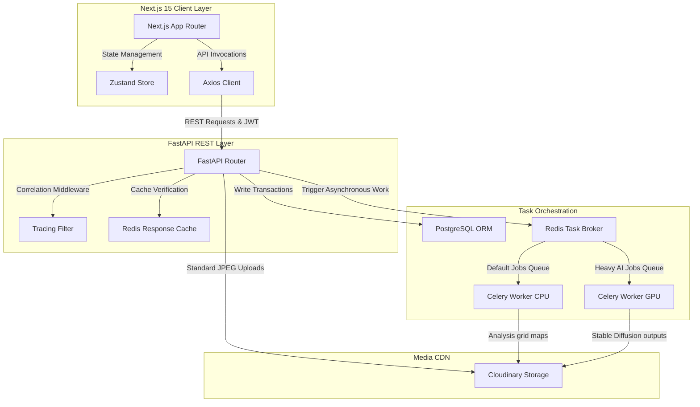
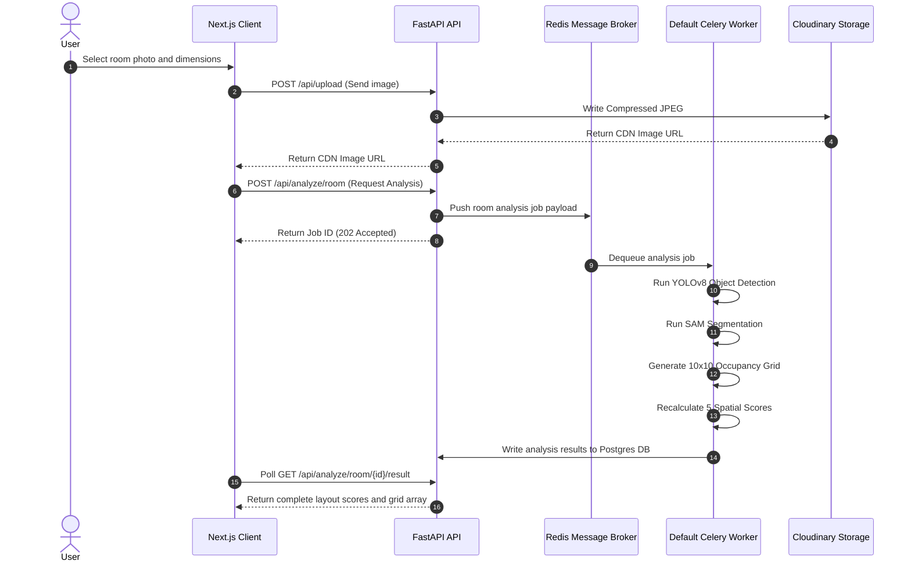
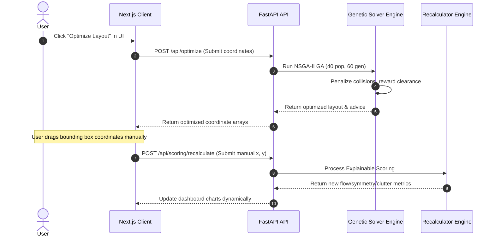

# 🏠 Matter AI — Architecture & System Design Document

This document details the software architecture, design choices, system topology, and critical design records (ADRs) of the Matter AI platform.

---

## 1. System Topology & Monorepo Structure

Matter AI is designed as a decoupled monorepo structured to split compute workloads and optimize delivery speeds. The architecture consists of a Next.js 15 frontend client, an asynchronous FastAPI REST API server, PostgreSQL data persistence, Redis caching/message brokers, and containerized Celery worker pools.

The workspace directory layout is split into two primary folders:
* [backend/](file:///k:/Work/projects/HomeDecor/backend): FASTAPI application hosting logic, security, and AI models.
* [frontend/](file:///k:/Work/projects/HomeDecor/frontend): Next.js web application utilizing Tailwind CSS v4 and Framer Motion.

---

## 2. Core Architectural Decisions (ADRs)

### ADR 01: Decoupling Spatial Reasoning (Deterministic) from Style Generation (Generative)
* **Context**: Traditional generative design tools output hallucinations, making it impossible to guarantee placement margins, accessibility regulations, or structural clearance.
* **Decision**: We split spatial design into a **deterministic space mapping pipeline** and a **generative styling pipeline**.
  * YOLOv8 bounding boxes ([detector.py](file:///k:/Work/projects/HomeDecor/backend/app/ai/detection/detector.py)) and Segment Anything Model segmentations ([segmenter.py](file:///k:/Work/projects/HomeDecor/backend/app/ai/segmentation/segmenter.py)) first map the layout coordinates into an occupancy grid ([mapper.py](file:///k:/Work/projects/HomeDecor/backend/app/ai/space_mapping/mapper.py)).
  * A custom Genetic Algorithm constraint solver ([solver.py](file:///k:/Work/projects/HomeDecor/backend/app/ai/optimization/solver.py)) optimizes the 2D layout layout under physical clearance boundaries.
  * Stable Diffusion generative models ([generator.py](file:///k:/Work/projects/HomeDecor/backend/app/ai/generation/generator.py)) are strictly limited to rendering style layers (Japandi, Scandinavian) on top of the calculated layout.
* **Consequence**: This guarantees explainable spatial metrics (flow, clutter, accessibility scores) and ensures that generative AI never introduces layout overlap bugs.

### ADR 02: Queue Separation (CPU CPU/Default Tasks vs GPU Heavy Tasks)
* **Context**: Object detection, coordinate grid calculations, and layout solvers execute fast on CPUs, taking 1 to 5 seconds. Stable Diffusion renders require dedicated GPU acceleration and take 15 to 30 seconds. Running them on a single worker pool blocks layout analysis tasks.
* **Decision**: Establish dual Celery task queues:
  * `default`: Handles YOLO/SAM scans and Genetic Layout calculations, run by CPU Celery workers.
  * `heavy_ai`: Handles Stable Diffusion generative restyling tasks, executed on GPU-backed containers.
* **Consequence**: Task workloads are scaled independently. CPU workers scale horizontally under high upload volume without spawning expensive GPU instances.

### ADR 03: Hybrid Relational-Embedded JSON Database Schema
* **Context**: Relational structures are ideal for standard tables (Users, Rooms, Renders) but struggle with dynamic objects like coordinate lists, occupancy grids, and collision graphs.
* **Decision**: Use a hybrid model where relational associations are managed by PostgreSQL foreign keys, while complex multi-dimensional metrics (e.g., the 10x10 occupancy matrix or NetworkX collision nodes) are stored as raw JSON fields directly in the `analyses`, `optimizations`, and `redesigns` tables.
* **Consequence**: Mapped via [analysis.py](file:///k:/Work/projects/HomeDecor/backend/app/models/analysis.py), this maintains structural integrity while eliminating complex, multi-table joins for grid coordinate maps.

### ADR 04: Context-Aware Request Tracing & Correlation IDs
* **Context**: In asynchronous applications with concurrent API operations, logs easily lose tracing relevance, making exceptions difficult to debug across async boundaries.
* **Decision**: Implement a custom FastAPI middleware ([middleware.py](file:///k:/Work/projects/HomeDecor/backend/app/core/middleware.py)) that assigns/extracts a unique Correlation ID (`X-Correlation-ID`) for each request. It writes the ID to a thread-safe `ContextVar` context block, which is captured by the logging module filter.
* **Consequence**: Every log line generated within a transaction is stamped with its `CID` identifier, facilitating trace debugging.

### ADR 05: Redis-Backed Path-Based Caching Layer
* **Context**: Analysis stats, style libraries, and room histories change infrequently but represent high database read volume.
* **Decision**: Build an inline response caching decorator ([cache.py](file:///k:/Work/projects/HomeDecor/backend/app/utils/cache.py)) that serializes FastAPI route outputs directly to Redis. Cache keys are generated dynamically based on request URL paths and query parameters.
* **Consequence**: Reduces SQL read operations. Repeat dashboard views yield sub-10ms response times.

---

## 3. Data Workflows & Communications

### Workflow A: Room Image Scan & Analysis Pipeline
This sequence maps how an upload is processed asynchronously:

---

### Workflow B: Layout Optimization & Recalculate Loop
This sequence processes Genetic Algorithm runs and handles manual canvas updates:

---

## 4. Component Mapping & Code References

### 4.1 Backend Architecture

The backend FastAPI structure is split logically across distinct layers:

* **Inference Layers**:
  * YOLO Detector: [detector.py](file:///k:/Work/projects/HomeDecor/backend/app/ai/detection/detector.py) (Detects furniture).
  * Space Mapper: [mapper.py](file:///k:/Work/projects/HomeDecor/backend/app/ai/space_mapping/mapper.py) (Maps the room boundaries to grid coordinates).
  * Genetic Solver: [solver.py](file:///k:/Work/projects/HomeDecor/backend/app/ai/optimization/solver.py) (Runs NSGA-II layout optimizations).
  * Recalculator: [scorer.py](file:///k:/Work/projects/HomeDecor/backend/app/ai/scoring/scorer.py) (Compiles clutter, flow, accessibility scores).
* **Database Models**:
  * Accounts: [user.py](file:///k:/Work/projects/HomeDecor/backend/app/models/user.py)
  * Room Scans: [room.py](file:///k:/Work/projects/HomeDecor/backend/app/models/room.py)
  * Bounding Boxes: [furniture.py](file:///k:/Work/projects/HomeDecor/backend/app/models/furniture.py)
  * Calculated Outputs: [analysis.py](file:///k:/Work/projects/HomeDecor/backend/app/models/analysis.py)
* **API Endpoints**:
  * Auth routes: [auth.py](file:///k:/Work/projects/HomeDecor/backend/app/api/routes/auth.py)
  * Upload pipelines: [upload.py](file:///k:/Work/projects/HomeDecor/backend/app/api/routes/upload.py)
  * Solver endpoints: [optimize.py](file:///k:/Work/projects/HomeDecor/backend/app/api/routes/optimize.py)
  * Synchronous metrics: [scoring.py](file:///k:/Work/projects/HomeDecor/backend/app/api/routes/scoring.py)

---

### 4.2 Frontend Architecture

The frontend Next.js 15 folder houses UI elements and state clients:

* **Interactive Pages**:
  * File upload entry: [page.tsx](file:///k:/Work/projects/HomeDecor/frontend/app/upload/page.tsx)
  * Research Metrics Grid: [page.tsx](file:///k:/Work/projects/HomeDecor/frontend/app/research/page.tsx)
  * Generative Studio: [page.tsx](file:///k:/Work/projects/HomeDecor/frontend/app/redesign/page.tsx)
  * Layout Comparison: [page.tsx](file:///k:/Work/projects/HomeDecor/frontend/app/compare/page.tsx)
* **State & Services Layer**:
  * Local Store client: [roomStore.ts](file:///k:/Work/projects/HomeDecor/frontend/store/roomStore.ts)
  * Room endpoints helper: [room.service.ts](file:///k:/Work/projects/HomeDecor/frontend/services/room.service.ts)
  * Recalculator connector: [scoring.service.ts](file:///k:/Work/projects/HomeDecor/frontend/services/scoring.service.ts)
* **Visualization Components**:
  * Grid visualization: [OccupancyGrid.tsx](file:///k:/Work/projects/HomeDecor/frontend/components/visualization/OccupancyGrid.tsx)
  * Heatmap overlay: [HeatmapViewer.tsx](file:///k:/Work/projects/HomeDecor/frontend/components/visualization/HeatmapViewer.tsx)
  * Box overlays: [DetectionOverlay.tsx](file:///k:/Work/projects/HomeDecor/frontend/components/visualization/DetectionOverlay.tsx)
  * Metrics gauges: [MetricGauge.tsx](file:///k:/Work/projects/HomeDecor/frontend/components/scoring/MetricGauge.tsx)
  * Radar charts: [RadarMetricChart.tsx](file:///k:/Work/projects/HomeDecor/frontend/components/charts/RadarMetricChart.tsx)

---

## 5. Security & Non-Functional Infrastructure

### 5.1 Authentication Flow
Authentication runs on JWT signatures utilizing secure algorithms:
* Passwords are encrypted on storage using `bcrypt` (12 rounds) at [security.py](file:///k:/Work/projects/HomeDecor/backend/app/core/security.py).
* Client requests pass a Bearer token evaluated by the security dependency injector at [auth.py](file:///k:/Work/projects/HomeDecor/backend/app/api/dependencies/auth.py).
* Invalid tokens yield standard HTTP 401 exceptions. Rate limiting is enforced at [rate_limiter.py](file:///k:/Work/projects/HomeDecor/backend/app/api/dependencies/rate_limiter.py).

### 5.2 Development vs Production Environment Specs
Infrastructure deployment models are containerized through distinct configurations:
* **Local Development**: Orchestrated via [docker-compose.yml](file:///k:/Work/projects/HomeDecor/backend/docker-compose.yml), running the FastAPI web server, DB, Redis, and a single Celery CPU worker.
* **Production Deployment**: Uses [docker-compose.prod.yml](file:///k:/Work/projects/HomeDecor/backend/docker-compose.prod.yml) and [render.yaml](file:///k:/Work/projects/HomeDecor/backend/render.yaml).
  * Web processes are locked to run as secure, non-root users.
  * Auto-scales API threads separately from GPU Celery queues.
  * Implements Redis persistent Append-Only Files (AOF) to ensure job queues survive server restarts.
