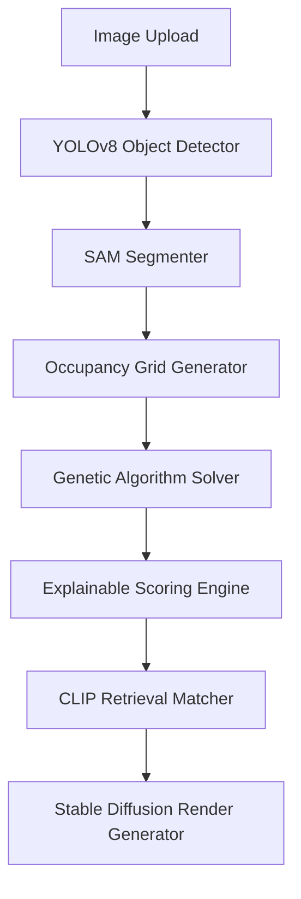
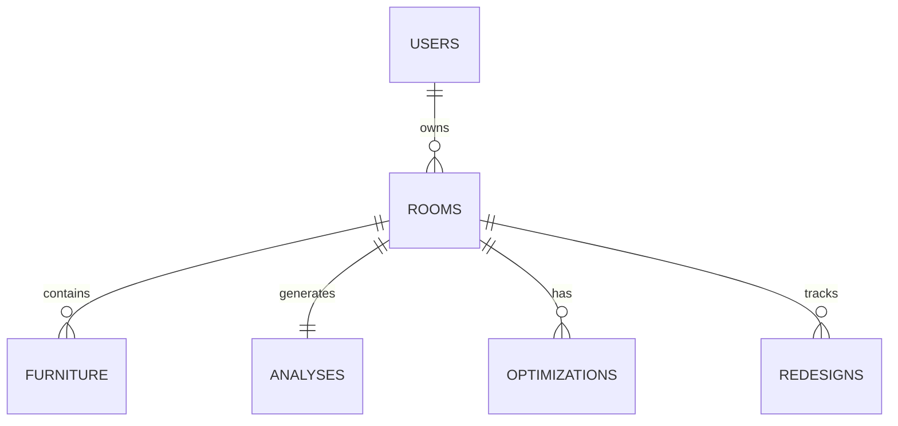

# 🏠 Matter AI — Product Requirement Document (PRD)

| Metadata | Value |
| --- | --- |
| **Product Name** | Matter AI |
| **Document Type** | Product Requirement Document (PRD) |
| **Status** | Active / Living Document |
| **Target Launch Date** | Q3 2026 |
| **Workspace Root** | [HomeDecor](file:///k:/Work/projects/HomeDecor) |

---

## 1. Executive Summary & Product Vision

Matter AI is a full-stack, research-grade SaaS platform designed to offer spatial intelligence, layout optimization, and generative restyling for residential and commercial interiors. The platform addresses the visual gap and spatial inefficiencies in home design by combining a deterministic spatial analysis pipeline with a generative design render studio. 

The application partitions its core value proposition into two distinct user modes:
1. **🔬 Research Lab Mode**: A purely deterministic workspace that performs computer-vision-based spatial layout calculations, generates 2D occupancy grids, and scores room layouts against explainable metrics (Clutter, Symmetry, Accessibility, Flow, and Lighting).
2. **🎨 Smart Design Studio Mode**: A generative, constraint-solving workspace that runs a room's furniture layout through a custom Genetic Algorithm to optimize positioning and clearance, and generates high-fidelity restyled room concepts using Stable Diffusion based on style prompts (e.g., Japandi, Scandinavian).

Unlike ordinary image-generation or virtual staging tools that hallucinate furniture placement and disregard real-world constraints, Matter AI operates on a **deterministic spatial intelligence substrate**. It ensures that every optimized recommendation is functionally viable, accessibility-compliant, and mathematically grounded before any aesthetic generation is rendered.

---

## 2. Core Architecture & Tech Stack

The system is developed as a containerized, decoupled monorepo containing a Python FastAPI backend and a Next.js 15 frontend.

```
HomeDecor/
├── backend/                  # Python API, AI Engines, & Celery workers
└── frontend/                 # Next.js 15 App Router web client
```

### Backend Tech Stack
* **FastAPI (v0.110+)**: Async REST framework handling routes, validation, and database operations. Mounted at [main.py](file:///k:/Work/projects/HomeDecor/backend/app/main.py).
* **Python (3.12+)**: Core runtime for database orchestration and AI inference.
* **PostgreSQL (v15)**: Relational database storing user records, room states, analyses, optimizations, and redesign histories.
* **SQLAlchemy (v2.0+) & Alembic (v1.3+)**: Typed ORM mapping and database migrations.
* **Celery (v5.3+) & Redis (v7)**: Distributed task workers mapping background processing jobs with Redis acting as broker and result backend.
* **Pillow (v10.2+)**: Local image compression, format standardization, and progressive JPEG encoding.
* **Cloudinary CDN**: External media hosting for room uploads in production.

### Frontend Tech Stack
* **Next.js (v15.x/16.x) & React (v19.x)**: File-system-routed React framework utilizing Server Components and client-side layouts. Central structure in [layout.tsx](file:///k:/Work/projects/HomeDecor/frontend/app/layout.tsx).
* **TypeScript (v5.x)**: Static type checks across client states and API communications.
* **Tailwind CSS v4**: Utility-first styling engine.
* **Zustand (v5.x)**: Lightweight client state management configured at [roomStore.ts](file:///k:/Work/projects/HomeDecor/frontend/store/roomStore.ts).
* **TanStack Query (v5.x)**: Async server state synchronizer, query caching, and status polling.
* **Framer Motion (v12.x)**: Entrance transitions and dynamic micro-animations.
* **Recharts (v3.x)**: Radar chart metrics visualization.
* **Axios (v1.18+)**: API client configured with request interceptors for token injection at [api.ts](file:///k:/Work/projects/HomeDecor/frontend/services/api.ts).

---

## 3. Core AI Engine & Pipeline Flow

The AI pipeline separates spatial reasoning from image synthesis. Only the final image rendering stage uses generative AI.



### AI Pipeline Components:
* **YOLOv8 Detection**: Implemented in [detector.py](file:///k:/Work/projects/HomeDecor/backend/app/ai/detection/detector.py). Detects key furniture classes (`Sofa`, `Coffee Table`, `Armchair`, `Bed`, `Bookshelf`, `Door`, `Window`) with bounding boxes and confidence metrics.
* **SAM Segmentation**: Implemented in [segmenter.py](file:///k:/Work/projects/HomeDecor/backend/app/ai/segmentation/segmenter.py). Isolates wall borders and floor margins as coordinate-based free-space masks.
* **Space Mapping**: Implemented in [mapper.py](file:///k:/Work/projects/HomeDecor/backend/app/ai/space_mapping/mapper.py). Generates a 2D matrix representing walkable, occupied, and clearance-buffer cells.
* **Genetic Algorithm Solver**: Implemented in [solver.py](file:///k:/Work/projects/HomeDecor/backend/app/ai/optimization/solver.py). Executes NSGA-II Multi-Objective optimization with the following specifications:
  * *Parameters*: Population Size = 40, Generations = 60, Mutation Rate = 0.20, Crossover Rate = 0.75.
  * *Objectives*: Minimizes bounding box overlaps, door/window pathway obstruction, and asymmetry; maximizes perimeter alignment and clear path vectors.
  * *Output*: Optimized coordinate positions and explainable text-based layout adjustment suggestions.
* **Explainable Scoring**: Implemented in [scorer.py](file:///k:/Work/projects/HomeDecor/backend/app/ai/scoring/scorer.py). Renders 0-100 scores across:
  * *Clutter*: Occupied floor ratio against room dimensions.
  * *Symmetry*: Absolute midline horizontal offsets of matching furniture configurations.
  * *Accessibility*: Clearance buffer width around detected pathways.
  * *Flow*: Computed index based on layout walkability.
  * *Lighting*: Windows orientation vs key occupancy spots.
* **CLIP Retrieval**: Implemented in [retriever.py](file:///k:/Work/projects/HomeDecor/backend/app/ai/retrieval/retriever.py). Matches text prompt style requirements to style catalog assets.
* **Stable Diffusion Renditions**: Implemented in [generator.py](file:///k:/Work/projects/HomeDecor/backend/app/ai/generation/generator.py). Performs final image styling rendering.

---

### 3.1 Core Spatial Intelligence Engine

The core intelligence layer of Matter AI differentiates it from ordinary visual-staging tools by implementing rigorous geometric and semantic space-modeling checks:

* **Spatial Reasoning**: Resolves structural dependencies between bounding boxes. Instead of viewing furniture as isolated rectangles, the engine models semantic relationships (e.g., a "coffee table" is functionally anchored to a "sofa" and must remain within a relative distance threshold).
* **Furniture Inflation & Clearance Zone Generation**: To maintain accessibility, detected furniture bounds are padded with "inflation envelopes" representing clearance margins. A sofa is padded by 0.6m in front to allow legroom, while dining tables are padded by 0.8m to allow chair pull-out operations.
* **Collision Detection & Boundary Constraints**: Evaluates bounding box intersections (Intersection over Union - IoU) against structural components. Layout elements are constrained within wall segments parsed by [segmenter.py](file:///k:/Work/projects/HomeDecor/backend/app/ai/segmentation/segmenter.py).
* **Door and Window Constraints**: Doors and windows are marked as dynamic exclusion zones. The spatial planner enforces a strict exclusion zone (typically 0.9m radius) in front of doorways to maintain exit compliance, and prevents tall furniture (bookshelves, wardrobes) from blocking windows to preserve natural light vectors.
* **Reachability Analysis & Walking Path Simulation**: Models human movement using A* pathfinding. The engine simulates a user walking through the room from entryways to key focal areas (e.g., entry door to bed).
* **Accessibility Graph & Topology Understanding**: Builds a topological connectivity map of the room, modeling walk paths as edges and functional areas as nodes. If the connectivity graph becomes disjointed (i.e., a pathway is blocked), the layout is flagged as access-deficient.
* **Spatial Relationship Graph**: Evaluates alignment, visual midline balance, and clustering rules (e.g., centering the entertainment center with the primary sofa) to model the human perception of space balance.

---

### 3.2 Occupancy Grid Subsystem

The occupancy grid translates continuous coordinates into discrete cell configurations to evaluate spatial metrics:

* **Dynamic Grid Sizing**: Rather than using a static 10×10 grid for all rooms, the engine generates grids dynamically based on room aspect ratios and dimensions (e.g., a 12x16m room generates a high-resolution grid structure to preserve accuracy).
* **Cell Classification Hierarchy**:
  * *Walkable Cells (Empty)*: Unobstructed pathways available for human transit.
  * *Occupied Cells (Static obstacles)*: Cells covered by primary furniture items.
  * *Buffer Zones & Clearance Margins*: Envelopes reserved around structural objects (e.g., doorways, walkways, windows) to ensure safety.
* **Obstacle Inflation & Collision Mapping**: Calculates distance transforms to identify how close any given walkable cell is to the nearest obstacle boundary, marking narrow choke points in red.
* **Continuous Grid Support**: Details future optimization transitions from discrete occupancy cells to coordinate vector geometry using continuous polygon operations, reducing resolution-dependent rounding errors.

---

### 3.3 Multi-Objective Layout Optimization Solver

The Genetic Algorithm solver optimized layout parameters through specific operations:

* **Semantic Adaptive Mutation**: Mutates furniture coordinates dynamically. The mutation step size is scaled based on item types—small chairs mutate with larger spatial variance, while heavy beds or anchored wall items mutate within highly constrained bounds.
* **Elite Preservation & Constraint Repair**: Employs elitism to pass the top 10% of high-scoring layout schemes directly into the next generation. Offspring violating hard boundaries (e.g., coordinates placed outside the walls) are passed to a repair function that shifts them back to the nearest boundary.
* **Pareto Ranking & Fitness Functions**: Since layout design is multi-objective, the solver evaluates populations across distinct fitness vectors:
  * **Symmetry Optimization**: Center alignment of structural pairs.
  * **Visual Balance Optimization**: Distributing furniture volume uniformly relative to the room center.
  * **Functional Layout Optimization**: Ensuring clear lines of sight between TVs and seating.
* **Furniture Locking (Soft & Hard Constraints)**: Enables users to lock specific objects in place (e.g., a massive piano that cannot be moved). Lock elements represent hard constraints, blocking coordinate updates during mutation phases.

---

### 3.4 Explainable AI (XAI) Subsystem

Rather than operating as a black-box optimizer, Matter AI yields human-interpretable justifications for every layout choice:

* **Metric-by-Metric Explanations**: Scores are broken down into descriptive categories (e.g., "Accessibility score dropped because the bed clearance envelope overlaps with the closet door").
* **Reason Generation Engine**: Automatically drafts improvement logs comparing before vs. after metrics. 
  * *Example*: `"Move sofa 0.5m left because walkway path width increases by 28% and balances the room midline axis."`
* **Confidence & Recommendation Ratings**: Computes a confidence metric for each recommendation based on historical layout constraints.
* **Human-Readable Optimization Reports**: Compiles structural improvements into clear visual cards shown in the frontend at [OptimizationBreakdown.tsx](file:///k:/Work/projects/HomeDecor/frontend/components/scoring/OptimizationBreakdown.tsx).

---

### 3.5 Style Retrieval Engine

The styling layer integrates semantic prompt descriptions with curated collections to feed the rendering pipelines:

* **CLIP Embedding Search**: Projects text prompts (e.g., "Warm Japandi with oak textures") and local product catalogs into a shared vector space, performing cosine similarity queries to retrieve matched materials.
* **Semantic Style Matching & Moodboard Retrieval**: Suggests curated accent furniture and matching decor accessories that fit the user's primary style preferences.
* **Style Taxonomy**: Enforces strict stylistic bounds for materials (e.g., Japandi restricts color tones to neutral warm tones, off-whites, and natural oak wood materials).
* **Color Palette & Material Recommendations**: Identifies accent colors from the generated renders and provides color codes (HEX/RGB) for wall paints and matching textiles.

---

### 3.6 Future Computer Vision Support

To remain future-proof, the computer vision pipeline is decoupled and model-agnostic:

* **Florence-2 & Grounding DINO Support**: Prepares for text-guided zero-shot object detection, enabling the detection of custom furniture items not supported by standard COCO datasets.
* **SAM2 Compatibility**: Enables dynamic segmentation tracking from video frames or multi-angle photos of the same room.
* **Modular Detection Pipelines**: Allows the development team to swap model weights or switch from local fallback algorithms to remote cloud detectors without modifying the backend service layer.

---

### 3.7 Smart Design Studio Pipeline Workflow

The generative redesign pipeline follows a strict end-to-end sequencing flow:

```
[Image Upload]
      │
      ▼
[Object Detection (YOLOv8/DINO)]
      │
      ▼
[Spatial Segmentation (SAM/OpenCV)]
      │
      ▼
[Constraint Extraction (Clearance zones, doors, windows)]
      │
      ▼
[Layout Optimization (Genetic Solver runs)]
      │
      ▼
[Style Retrieval (CLIP matching style prompts to assets)]
      │
      ▼
[Prompt Construction (Injecting spatial coordinates & styles)]
      │
      ▼
[Image Generation (Stable Diffusion rendering)]
      │
      ▼
[Validation (Quality check on lighting and consistency)]
      │
      ▼
[Final Render Output & Before/After comparison]
```

1. **Image Upload**: Uploads raw assets via [upload.py](file:///k:/Work/projects/HomeDecor/backend/app/api/routes/upload.py).
2. **Object Detection**: Identifies and logs furniture coordinates via [detector.py](file:///k:/Work/projects/HomeDecor/backend/app/ai/detection/detector.py).
3. **Spatial Analysis**: Identifies room boundaries, dimensions, and wall margins.
4. **Constraint Extraction**: Automatically extracts structural margins, window heights, and doorway bounds.
5. **Optimization**: Solves layout problems using [solver.py](file:///k:/Work/projects/HomeDecor/backend/app/ai/optimization/solver.py).
6. **Style Retrieval**: Uses CLIP tags to find decor moodboards in the database.
7. **Prompt Construction**: Merges style metadata and spatial tags into an optimized image generation prompt.
8. **Image Generation**: Generates high-fidelity restyled rooms via [generator.py](file:///k:/Work/projects/HomeDecor/backend/app/ai/generation/generator.py).
9. **Validation**: Automated post-processing quality checks to ensure the generated image matches the physical boundaries of the room.
10. **Final Render**: Outputs the restyled scene, updating Zustand stores and rendering the UI slider.

---

## 4. Database Schema Design

The system relies on six core relational models mapped via SQLAlchemy:



* **User**: [user.py](file:///k:/Work/projects/HomeDecor/backend/app/models/user.py)
  * Represents registered user accounts.
  * Fields: `id` (PK), `email` (Unique, Index), `hashed_password`, `full_name`, `is_active`, `tier` (`Free`, `Pro`, `Enterprise`), `created_at`.
* **Room**: [room.py](file:///k:/Work/projects/HomeDecor/backend/app/models/room.py)
  * Represents physical spaces uploaded by users.
  * Fields: `id` (PK), `name`, `image_url`, `space_type` (`living_room`, `bedroom`, `office`), `style_preference`, `length`, `width`, `unit` (`ft` or `m`), `user_id` (FK), `created_at`.
* **Furniture**: [furniture.py](file:///k:/Work/projects/HomeDecor/backend/app/models/furniture.py)
  * Mapped bounding box objects detected in rooms.
  * Fields: `id` (PK), `label` (e.g. `Sofa`), `x`, `y`, `width`, `height`, `confidence`, `room_id` (FK).
* **Analysis**: [analysis.py](file:///k:/Work/projects/HomeDecor/backend/app/models/analysis.py)
  * Relational table storing raw, parsed, and explainable metrics from room scans.
  * Fields: `id` (PK), `clutter_level` (`Low`, `Medium`, `High`), `symmetry_score` (0-100), `accessibility_score` (0-100), `overall_score` (0-100), `flow_score` (0-100), `lighting_score` (0-100), `occupancy_grid` (JSON mapping rows, columns, and cell states), `reasoning` (JSON containing layout insights), `graph_data` (JSON mapping coordinate collision graphs), `room_id` (FK, Unique), `created_at`.
* **Optimization**: [optimization.py](file:///k:/Work/projects/HomeDecor/backend/app/models/optimization.py)
  * Tracks background Genetic Algorithm tasks.
  * Fields: `id` (PK), `status` (`pending`, `running`, `completed`, `failed`), `original_scores` (JSON), `optimized_scores` (JSON), `suggestions` (JSON), `room_id` (FK), `created_at`.
* **Redesign**: [redesign.py](file:///k:/Work/projects/HomeDecor/backend/app/models/redesign.py)
  * Tracks generative AI image styling jobs.
  * Fields: `id` (PK), `status` (`pending`, `generating`, `completed`, `failed`), `prompt`, `selected_style`, `original_image_url`, `redesigned_image_url` (CDN path), `suggestions` (JSON), `room_id` (FK), `created_at`.

---

## 5. Detailed Functional Requirements

### 5.1 User Registration & Session Management
* **Authentication Route**: Users authenticate at [auth.py](file:///k:/Work/projects/HomeDecor/backend/app/api/routes/auth.py).
* **Token Rotation**: Implements JWT Access tokens (30 min lifetime) and Refresh tokens (7 days lifetime).
* **Tier Enforcement**: API controllers rate-limit and segment feature availability (e.g., number of active scans or access to GPU worker queues) based on the user's `tier` (`Free`, `Pro`, `Enterprise`).

### 5.2 Room Scan & Upload Flow
* **Interface**: Drag-and-drop dropzone in [page.tsx](file:///k:/Work/projects/HomeDecor/frontend/app/upload/page.tsx). Users upload files (max 5MB) and specify metadata (length, width, room type, style preference).
* **Processing Controller**: The upload endpoint at [upload.py](file:///k:/Work/projects/HomeDecor/backend/app/api/routes/upload.py) compresses image assets, saves them to Cloudinary/local directories, and saves Room records via [room_service.py](file:///k:/Work/projects/HomeDecor/backend/app/services/room_service.py).
* **Pipeline Launch**: Creates a room and triggers Celery analysis tasks via the room scan pipeline at [analyze.py](file:///k:/Work/projects/HomeDecor/backend/app/api/routes/analyze.py).

### 5.3 Research Lab (Spatial Metrics Dashboard)
* **Route**: Mounted client-side at [page.tsx](file:///k:/Work/projects/HomeDecor/frontend/app/research/page.tsx).
* **Occupancy Grid Visualizer**: Renders an interactive 10x10 grid detailing blocked vs clear space using [OccupancyGrid.tsx](file:///k:/Work/projects/HomeDecor/frontend/components/visualization/OccupancyGrid.tsx).
* **Heatmap & Bounding Boxes**: Overlays OpenCV/SAM walls and detected YOLO coordinates directly onto the image using [HeatmapViewer.tsx](file:///k:/Work/projects/HomeDecor/frontend/components/visualization/HeatmapViewer.tsx) and [DetectionOverlay.tsx](file:///k:/Work/projects/HomeDecor/frontend/components/visualization/DetectionOverlay.tsx).
* **Metrics Radar Chart**: Uses [RadarMetricChart.tsx](file:///k:/Work/projects/HomeDecor/frontend/components/charts/RadarMetricChart.tsx) to plot all 5 spatial indexes simultaneously.

#### 5.3.1 Detailed Research Lab Artifacts

The analysis pipeline generates a complete suite of spatial assets stored in the database and accessible via API:
* **Occupancy Grid & Collision Map**: Matrix mapping walkable cell areas, bounding boxes, and collision risk areas.
* **Symmetry & Flow Heatmaps**: Gradient visualizations identifying high-symmetry pathways vs. congested pathways.
* **Furniture & Reachability Graph**: Network node graphs outlining clearance zones and reachability metrics.
* **Metrics Dashboard**: A dashboard showing clutter indexes, flow percentages, and light score charts.
* **Optimization & Explainable Recommendation Reports**: Comprehensive, downloadable PDF/JSON files outlining suggested moves, alignment corrections, and space-saving tips.

### 5.4 Smart Design Studio (Layout Optimizer & Restyler)
* **Route**: Client interface configured at [page.tsx](file:///k:/Work/projects/HomeDecor/frontend/app/redesign/page.tsx).
* **Layout Optimization**: Executes the Genetic Solver by calling [optimize.py](file:///k:/Work/projects/HomeDecor/backend/app/api/routes/optimize.py), yielding step-by-step room modifications and delta metrics shown in [OptimizationBreakdown.tsx](file:///k:/Work/projects/HomeDecor/frontend/components/scoring/OptimizationBreakdown.tsx).
* **Style Selection & Rendering**: Dispatches redesign tasks using [redesign.py](file:///k:/Work/projects/HomeDecor/backend/app/api/routes/redesign.py). Renders are executed via Stable Diffusion pipelines matching selected prompts.
* **Before/After Comparer**: Evaluates original layouts vs redesign outputs with an interactive slider in [BeforeAfterSlider.tsx](file:///k:/Work/projects/HomeDecor/frontend/components/comparison/BeforeAfterSlider.tsx).

### 5.5 Room Metric Comparison Tool
* **Route**: Renders at [page.tsx](file:///k:/Work/projects/HomeDecor/frontend/app/compare/page.tsx).
* **Side-by-Side Comparison**: Enables users to compare two rooms or layout states directly using the [ComparisonGrid.tsx](file:///k:/Work/projects/HomeDecor/frontend/components/comparison/ComparisonGrid.tsx) component, overlaying absolute differences in spatial ratings (e.g. `+15` flow score).

### 5.6 Wall Art & Object Visualization (Planned / Upcoming)
* **Goal**: Enable users to upload pictures of wall-bound elements (art frames, mirrors, shelving units) and visualize them mounted realistically on their actual walls.
* **Workflow**:
  * The user uploads a photo of their wall, and either uploads a physical picture of the object or enters a text search description.
  * The backend utilizes space segmentation tools to isolate wall surface boundaries and compute lighting direction, scale ratios, and perspective lines.
  * If a text query is entered instead of a photo, the backend uses the Unsplash API to retrieve matching high-fidelity, isolated object images.
  * The server-side compositing pipeline performs homography alignment and casts soft shadows to render the combined result.
  * The frontend displays the composite design in the design workspace.

### 5.7 Extended SaaS & Team Collaboration Features
* **Multi-Project Workspaces**: Users can organize room scans under specific projects (e.g., "Living Room Reno Q3" or "Client: Aggarwal Residence").
* **Saved Room & Version History**: Tracks layout edits over time, allowing users to restore previous furniture configurations and scores.
* **Design Iterations Comparison**: Enables side-by-side comparison of different aesthetic restyling outcomes (e.g., Japandi vs. Mid-Century Modern).
* **Shared Workspaces & Team Collaboration**: Pro and Enterprise users can invite designers, clients, or family members to view layouts, post feedback, or edit coordinate layouts in real-time.
* **Export Reports & Client Presentations**: Generates polished, client-facing PDF presentations containing before/after renders, spatial scores, and paint/material specifications.
* **Cloud Sync & Portfolio Pages**: Allows users to publish completed spatial redesigns to a public web page to display design capabilities.

---

## 6. REST API Endpoints

All communication passes through the FastAPI controller mounted at [router.py](file:///k:/Work/projects/HomeDecor/backend/app/api/router.py).

| HTTP Method | Path | Queue Usage | Description | File Reference |
| :--- | :--- | :--- | :--- | :--- |
| `POST` | `/api/auth/signup` | None | Create a new user profile. | [auth.py](file:///k:/Work/projects/HomeDecor/backend/app/api/routes/auth.py) |
| `POST` | `/api/auth/login` | None | Authenticate credentials & return JWT tokens. | [auth.py](file:///k:/Work/projects/HomeDecor/backend/app/api/routes/auth.py) |
| `POST` | `/api/auth/refresh` | None | Rotate refresh tokens for active sessions. | [auth.py](file:///k:/Work/projects/HomeDecor/backend/app/api/routes/auth.py) |
| `GET` | `/api/auth/me` | None | Retrieve authenticated user schema details. | [auth.py](file:///k:/Work/projects/HomeDecor/backend/app/api/routes/auth.py) |
| `POST` | `/api/upload` | None | Compress and upload image assets to media storage. | [upload.py](file:///k:/Work/projects/HomeDecor/backend/app/api/routes/upload.py) |
| `POST` | `/api/analyze/room` | `default` | Parse uploaded room dimensions and initiate YOLO/SAM scans. | [analyze.py](file:///k:/Work/projects/HomeDecor/backend/app/api/routes/analyze.py) |
| `GET` | `/api/analyze/rooms` | None | List all rooms mapped to the authenticated user. | [analyze.py](file:///k:/Work/projects/HomeDecor/backend/app/api/routes/analyze.py) |
| `GET` | `/api/analyze/room/{id}/result`| None | Retrieve occupancy grid mappings and scores. | [analyze.py](file:///k:/Work/projects/HomeDecor/backend/app/api/routes/analyze.py) |
| `POST` | `/api/optimize` | `default` | Launch Genetic Solver placement optimization job. | [optimize.py](file:///k:/Work/projects/HomeDecor/backend/app/api/routes/optimize.py) |
| `GET` | `/api/optimize/{job_id}` | None | Poll execution status of layout solver task. | [optimize.py](file:///k:/Work/projects/HomeDecor/backend/app/api/routes/optimize.py) |
| `POST` | `/api/redesign` | `heavy_ai` | Trigger prompt-based Stable Diffusion redesign render. | [redesign.py](file:///k:/Work/projects/HomeDecor/backend/app/api/routes/redesign.py) |
| `GET` | `/api/redesign/{job_id}` | None | Poll status of image styling render job. | [redesign.py](file:///k:/Work/projects/HomeDecor/backend/app/api/routes/redesign.py) |
| `POST` | `/api/scoring/recalculate` | None | Recalculate scores synchronously for manual coordinates. | [scoring.py](file:///k:/Work/projects/HomeDecor/backend/app/api/routes/scoring.py) |
| `GET` | `/api/retrieval/inspirations` | None | Query style inspiration catalog matching keywords. | [retrieval.py](file:///k:/Work/projects/HomeDecor/backend/app/api/routes/retrieval.py) |
| `GET` | `/api/compare` | None | Calculate spatial delta stats between two rooms. | [compare.py](file:///k:/Work/projects/HomeDecor/backend/app/api/routes/compare.py) |
| `POST` | `/api/wall-art/visualize` | `default` | Composite and project target objects/Unsplash imagery onto a wall image. | [wall_art.py](file:///k:/Work/projects/HomeDecor/backend/app/api/routes/wall_art.py) |

---

## 7. Non-Functional Requirements

### 7.1 Performance & Scalability
* **API Latency**: Synchronous requests (excluding AI generation runs) must return responses within 200ms. Response caching is handled via Redis cache decorators in [cache.py](file:///k:/Work/projects/HomeDecor/backend/app/utils/cache.py).
* **Asynchronous Offloading**: Long-running layout computations and heavy GPU-based rendering runs must be isolated to prevent thread blocks on the primary FastAPI HTTP thread. 
* **Worker Queue Separation**:
  * *Default Queue*: Standard CPU workers processing fast detection arrays and layout optimizations.
  * *Heavy AI Queue*: GPU-supported workers running Stable Diffusion image synthesis workloads. Configured in [docker-compose.prod.yml](file:///k:/Work/projects/HomeDecor/backend/docker-compose.prod.yml).

### 7.2 Security & Compliance
* **Data Transit**: TLS 1.3 encryption across all HTTP endpoints.
* **Credentials**: Hashed passwords stored using `bcrypt` (rounds = 12) at [security.py](file:///k:/Work/projects/HomeDecor/backend/app/core/security.py).
* **Payload Validation**: Strict structure, size boundaries (max 5MB uploads), and data types parsed automatically through Pydantic V2 schemas.
* **Rate Limiting**: Sliding-window rate limit checks targeting API access tokens, backed by Redis counts.

---

## 8. Release Phases & Planned Roadmap

```
Phase 1 (Completed) ──► Phase 2 (Completed) ──► Phase 3 (Completed) ──► Phase 4 (Upcoming) ──► Phase 5 (Planned) ──► Phase 6 (Planned)
```

### Phase 1: Foundation & Spatial Analysis (Completed)
* Core AI engines developed and packaged (YOLOv8 detection, SAM segmentation, and occupancy mapper).
* NSGA-II Genetic layout optimizer engineered with overlap and boundary penalties.
* Metric calculations established for clutter, symmetry, flow, and accessibility.

### Phase 2: Core Platform & Pipeline (Completed)
* Relational DB models schema initialized via Alembic.
* User auth module completed (JWT tokens, password hashing).
* Celery task scheduling pipelines implemented.
* Local and Cloudinary file system storage clients decoupled.

### Phase 3: Interactive UI Studio (Completed)
* Developed Next.js dashboard layout displaying recent room metrics.
* Added dropzone uploading and prompt selection forms.
* Built interactive visualizers: SVG occupancy grids, bounding boxes, radar graphs, and before/after comparison sliders.

### Phase 4: Staged Redesign & Coordinates Editing (Planned / Upcoming)
* **Goal**: Enable interactive, manual coordinate editing directly on the user dashboard.
* **Scope**:
  * Users can drag and resize bounding boxes representing furniture directly on a grid canvas in [frontend/app/redesign/page.tsx](file:///k:/Work/projects/HomeDecor/frontend/app/redesign/page.tsx).
  * The frontend will intercept mouse coordinate offsets and send them to the recalculation endpoint `/api/scoring/recalculate`.
  * The scoring engine [scorer.py](file:///k:/Work/projects/HomeDecor/backend/app/ai/scoring/scorer.py) will synchronously return updated flow, clutter, accessibility, and symmetry metrics, reflecting layout changes instantly in the UI.

### Phase 5: Wall Art & Object Visualization (Planned / Upcoming)
* **Goal**: Allow users to upload photos of objects (frames, shelves, clocks) or describe objects to visualize them superimposed realistically on their walls.
* **Scope**:
  * The backend detects flat wall regions, surfaces, margins, and perspective properties of the room layout.
  * Intersects with the Unsplash API or a dedicated catalog system to search and extract clean image templates for desired furniture/art objects based on text descriptors.
  * Employs homography wrapping and local drop-shadow estimation algorithms to overlay objects seamlessly.
  * Front-end showcases visual previews under client projects.

### Phase 6: Projects Management & Portfolios (Planned / Future)
* **Goal**: Enable multi-room design folders and sharing features.
* **Scope**:
  * Implement "Projects" schema grouping multiple Room scan objects (e.g. `Living Room`, `Bedroom`, `Kitchen` associated with a single client project).
  * Build public-facing export links allowing users to generate shareable portfolio URLs showcasing side-by-side room optimization sliders.

### Phase 7: Stripe billing & Teams Collaboration (Future / Roadmap)
* **Goal**: Commercialize platform usage.
* **Scope**:
  * Integrate Stripe payment gateways to manage subscriber subscriptions.
  * Restrict access to Celery workers matching user levels (e.g. Free users queue tasks behind paid tiers, GPU restyler limits).
  * Implement real-time websockets enabling multiple designers to collaborate live on a single coordinate canvas.

---

## 9. AI Recommendation Engine

Matter AI includes a specialized, non-generative heuristics engine that evaluates room spatial configurations and suggests direct improvement actions:

* **Furniture Replacement Suggestions**: Recommends scaling down oversized items if the Clutter index exceeds 80%. If a sofa is too large for the walkable pathways, it suggests a list of space-compliant alternatives from matching catalogs.
* **Repositioning & Clearance Corrections**: Pinpoints coordinate translations. E.g., `"Shift armchair 0.4m right to resolve path bottleneck between door frame and coffee table."`
* **Space-Saving Product Matches**: Recommends functional space-savers (nesting tables, wall-mounted floating shelves, corner storage cabinets) based on unused wall gaps.
* **Aesthetic Styling Rules**: Computes visual weight distribution across the symmetry midline, recommending additions (e.g., adding an accent chair or table lamp) to balance high asymmetry values.
* **Budget-Aware Recommendations**: Integrates with retail APIs, allowing users to input a maximum price limit. Recommendations will prioritize layouts using lower-cost materials or staging options.

---

## 10. Subscription Tiers & Feature Breakdown

Matter AI operates on a tiered subscription pricing model, segments features by compute and workflow limits:

| Feature Capability | Free Tier | Pro Tier ($29/mo) | Enterprise Tier ($149/mo) |
| :--- | :--- | :--- | :--- |
| **Room Scan Scopes** | Max 3 active rooms | Unlimited | Unlimited |
| **Analysis Pipeline** | Standard CPU (YOLO fallback) | True GPU-accelerated YOLO/SAM | High-fidelity segmentation sweeps |
| **Layout Optimizations**| Standard NSGA-II Solver | Custom parameter lock profiles | Multi-constraint optimization |
| **Stable Diffusion Renders**| 5 renders / month | 250 renders / month | Unlimited (Dedicated GPU priority) |
| **SaaS Projects & History**| Room history only | Version history (max 30 iterations) | Full iterations + version branches |
| **Team Workspaces** | ❌ (Single seat) | ❌ (Single seat) | Unlimited seats + client portals |
| **Exports & Presentations**| Standard screen captures | Downloadable PDF reports | Custom white-label exports |
| **Support SLA** | Community support | 24-hour response SLA | Dedicated Slack + real-time assistance |

---

## 11. User Personas

To guide UX and design choices, the product is built around five target user profiles:

```
┌─────────────────┐    ┌─────────────────┐    ┌─────────────────┐
│    Homeowner    │    │    Designer     │    │   Real Estate   │
│  "Visualizer"   │    │ "Professional"  │    │  "Virt. Stager" │
└─────────────────┘    └─────────────────┘    └─────────────────┘
```

### Homeowner (Aesthetic Visualizer)
* **Goal**: Optimize layout without buying new furniture, or visualize room styling changes before purchasing.
* **Pain Points**: Spatial measurement confusion, inability to guess if a design layout will look congested, fear of buying mismatched items.
* **Core Workflow**: Uploads single room photo -> runs optimization solver -> reviews basic scores -> tries style prompts (e.g. "Cosy Japandi").

### Interior Designer (Professional Coordinator)
* **Goal**: Rapidly mock up initial space plans, calculate accessibility metrics, and share restyled room concepts with clients.
* **Pain Points**: Manually measuring floor layouts is slow, client reviews are highly subjective, and CAD modeling takes hours.
* **Core Workflow**: Uploads room photo -> adjusts bounding box grids manually -> exports visual PDFs containing before/after renderings and delta metrics -> presents layout versions to clients.

### Architect (Technical Planner)
* **Goal**: Review space utilization, evaluate structural pathways, and calculate clearance dimensions for building safety compliance.
* **Pain Points**: Generating clearance vectors is tedious; standard modeling software lacks automated pathfinding checks.
* **Core Workflow**: Runs scans to examine distance transforms and connectivity graphs -> ensures doorway exit margins are compliant.

### Real Estate Professional (Virtual Stager)
* **Goal**: Stage empty or cluttered properties digitally to make listings look attractive, minimizing real-world staging costs.
* **Pain Points**: Hiring physical staging services is expensive; standard staging graphics look artificial.
* **Core Workflow**: Scans cluttered properties -> applies restyling prompts to clean and restyle listings -> exports images for brochures.

### Furniture Retailer (Sales Accelerator)
* **Goal**: Offer visual product placements, allowing online buyers to "try out" furniture items in their rooms.
* **Pain Points**: High return rates from buyers who purchased items that did not fit.
* **Core Workflow**: Integrates Matter AI widget on product detail page -> enables buyers to upload room photo to check scale and clearance.

---

## 12. User Stories

### User Management & Authentication
* **Story 1**: *As a new designer*, I want to create a secure account with my credentials so that my project history is preserved.
* **Story 2**: *As an Enterprise admin*, I want access tokens to rotate regularly so that client files remain secure.

### Room Upload & Analysis
* **Story 3**: *As a homeowner*, I want to drag and drop a JPEG of my room, so that I can analyze it without formatting files.
* **Story 4**: *As an architect*, I want to configure custom dimensions (meters/feet) during upload, so that analysis metrics match blueprints.

### Research Lab & Metrics
* **Story 5**: *As a designer*, I want to view an overlay of the 2D occupancy grid, so that I can see exactly which spots are blocked.
* **Story 6**: *As an accessibility auditor*, I want a visual clearance warning on doorway exclusion zones, so that I can verify exit path safety.

### Layout Optimization & Editing
* **Story 7**: *As a designer*, I want to drag bounding boxes manually on a grid canvas, so that I can test custom layout revisions.
* **Story 8**: *As a designer*, I want the system to recalculate scores instantly when I move boxes, so that I can see the score impact of layout changes.

### Smart Design Studio (Generative)
* **Story 9**: *As a homeowner*, I want to enter custom style descriptions (e.g. "Industrial Loft"), so that I can visualize my room with different materials.
* **Story 10**: *As a virtual stager*, I want to slide an interactive bar to compare before vs. after renders, so that I can demonstrate the transformation.

### SaaS & Workspace Features
* **Story 11**: *As an Enterprise lead*, I want to invite clients to a shared workspace, so that they can review redesign revisions and leave comments.
* **Story 12**: *As a designer*, I want to export a PDF presentation of my spatial options, so that I can hand it to clients.

---

## 13. Success Metrics & Key Performance Indicators (KPIs)

To evaluate the product performance, we track these primary success vectors:

* **Average Analysis Time**: Target < 12 seconds for YOLO + SAM + occupancy mapping.
* **Optimization Latency**: Target < 3 seconds for NSGA-II Genetic layout configurations.
* **Rendering Time**: Target < 25 seconds for Stable Diffusion image synthesis queue response.
* **API Latency**: Target < 200ms response time for standard database read/write actions.
* **Detection Accuracy**: Target > 92% Mean Average Precision (mAP) for primary furniture categories.
* **Recommendation Acceptance Rate**: Target > 40% of suggestions (e.g. "Move bed") accepted or saved by users.
* **User Retention**: Target > 30% Month-1 retention for Pro/Enterprise accounts.
* **Platform Uptime**: Target 99.9% uptime for core API and web dashboard services.

---

## 14. Risks and Assumptions

### Risks
* **Occluded/Merged Furniture**: Furniture blocking each other (e.g. a chair behind a table) can cause YOLOv8 detection to fail.
  * *Mitigation*: Enable manual object addition and box editing in the UI.
* **Poor Image Lighting/Angles**: Low-light photos or extreme camera angles limit SAM boundary segmentation.
  * *Mitigation*: Require minimal dimensions (e.g., 1024px width) and display angle correction tips in the upload view.
* **GPU Cloud Scaling Costs**: Stable Diffusion render queues can become expensive under high traffic.
  * *Mitigation*: Enforce strict subscription limits on restyling commands and configure auto-scaling GPU nodes.
* **Rounding/Measurement Errors**: Users inputting incorrect room sizes will skew actual clearance dimensions.
  * *Mitigation*: Emphasize calibration rules in the user onboarding tutorial.

### Assumptions
* Users have internet speeds capable of uploading 5MB files without connection timeouts.
* Relational database tables scale well using JSON structures for grid cells.

---

## 15. Acceptance Criteria & Completion Definition

### 15.1 Room Analysis (Research Mode)
* **Criteria**:
  * Accepts standard image formats (JPEG, PNG) up to 5MB.
  * Identifies walls, doors, windows, and at least 3 classes of furniture in under 15 seconds.
  * Generates and writes an occupancy grid to the database.

### 15.2 Layout Optimization (Solver)
* **Criteria**:
  * Runs the NSGA-II solver on input coordinate schemas.
  * Prevents furniture boxes from overlapping with wall borders.
  * Returns optimized coordinates and at least 3 text recommendations in under 5 seconds.

### 15.3 Image Generation (Design Studio)
* **Criteria**:
  * Retrieves style assets based on CLIP similarity.
  * Synthesizes and saves a redesigned JPEG image to the cloud bucket.
  * Ensures structural consistency between the original room photo and generated output.

### 15.4 Room Comparison
* **Criteria**:
  * Retrieves two distinct room records and calculates score variations.
  * Renders score comparisons in the UI chart with correct colors for positive and negative deltas.

### 15.5 Wall Art Visualization
* **Criteria**:
  * Identifies a flat wall boundary plane from a user photo.
  * Composites target frame image onto the wall using homography coordinates.
  * Casts a realistic drop shadow.

### 15.6 User Authentication
* **Criteria**:
  * Registers accounts with unique email fields.
  * Protects routes with token signature checks.
  * Rate-limits users to prevent request flooding.

### 15.7 Research Dashboard
* **Criteria**:
  * Displays user room scan history.
  * Shows occupancy grids, heatmap overlays, and metrics radar charts.
  * Provides access links to detailed optimization cards.
